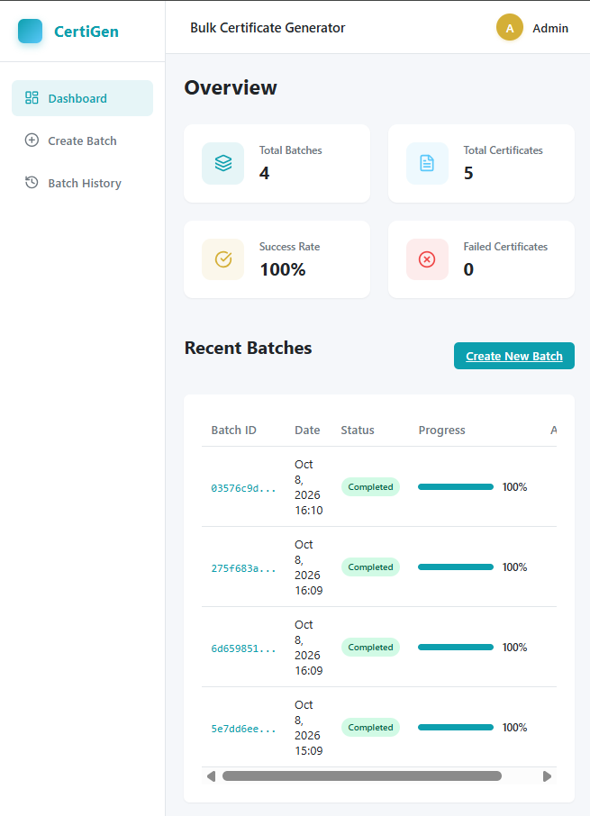
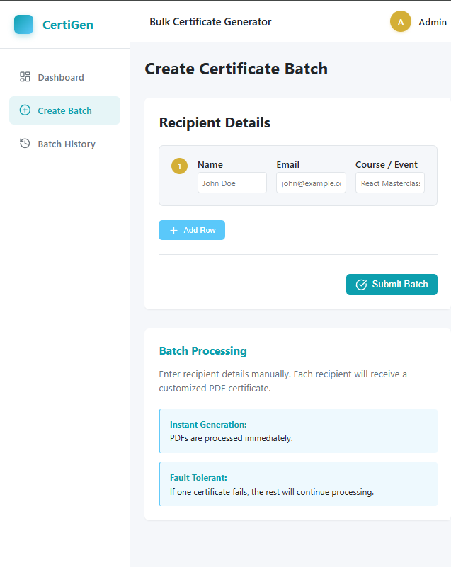
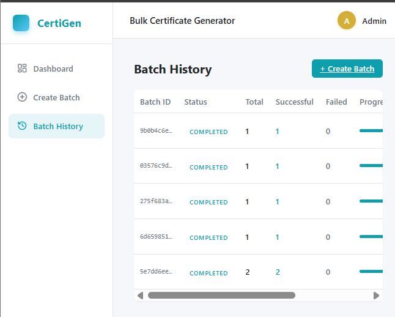
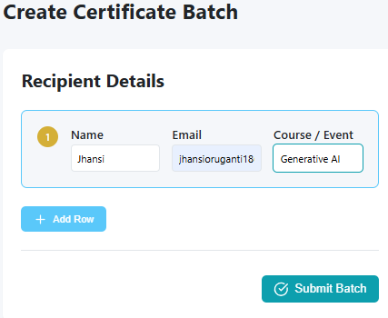

# AEREO Bulk Certificate Generator

## Project Overview
The AEREO Bulk Certificate Generator is a full-stack application designed to automate the process of generating large volumes of customized PDF certificates. It features a scalable FastAPI backend that handles asynchronous PDF generation and a dynamic, responsive React frontend.

## Application Screenshots

The following screenshots showcase the AEREO Bulk Certificate Generator web application running locally.

### 1. Dashboard
Displays total batches, total certificates, success rate, failed certificates, and recent batch activity.



### 2. Create Batch
Provides an interface for creating a new batch and entering recipient details for certificate generation.



### 3. Batch History
Displays previously created batches and their processing status and progress.



### 4. Recipient Details
Shows recipient information and certificate generation details.



## Problem Statement
Manually creating certificates for large batches of students or attendees is time-consuming and error-prone. Organizations need a system that can take a list of recipients, securely process them in bulk, isolate individual failures without crashing the entire batch, and provide a user-friendly interface to monitor progress and download results.

## Features
- **Bulk Processing**: Upload batches of recipients for automatic certificate generation.
- **Asynchronous Generation**: Non-blocking certificate generation ensuring the server handles high loads seamlessly.
- **Fault-Tolerant Processing**: Individual certificate failures do not halt the entire batch.
- **Real-Time Progress Tracking**: Dashboard and detailed views to track batch progress down to the individual certificate level.
- **RESTful API**: Comprehensive endpoints documented via Swagger UI.
- **Responsive Web UI**: A mobile-first designed React dashboard with a sleek enterprise-grade UI.
- **PDF Generation**: Generates high-quality branded PDF certificates using ReportLab.

## Technology Stack
**Backend**: Python, FastAPI, SQLAlchemy, SQLite, ReportLab, pytest, Uvicorn.
**Frontend**: React, Vite, React Router, Lucide Icons, Vanilla CSS (Mobile-First Responsive).
**Testing**: pytest (covering all APIs, Database schema, and PDF generation).

## Architecture
The application follows a client-server architecture:
- **Client (Frontend)**: React application communicating with the backend via REST API. It maintains state and handles user routing securely.
- **Server (Backend)**: FastAPI application structuring routes, enforcing schemas with Pydantic, executing business logic (certificate generation) in the services layer, and interacting with the database using SQLAlchemy.
- **Database**: SQLite optimized for concurrent operations and relational integrity between Batches and Certificates.

## Project Structure
```text
Bulk Certificate Generator/
├── backend/
│   ├── app/
│   │   ├── core/      # Configuration and settings
│   │   ├── db/        # Database session and base
│   │   ├── models/    # SQLAlchemy models (Batch, Certificate)
│   │   ├── routers/   # API endpoints (health, batches, certificates, dashboard)
│   │   ├── schemas/   # Pydantic validation schemas
│   │   ├── services/  # Business logic (PDF generation, bulk processing)
│   │   ├── utils/     # Helpers
│   │   └── main.py    # FastAPI application entrypoint
│   ├── tests/         # pytest suite
│   ├── requirements.txt
│   └── .env.example
└── frontend/
    ├── src/
    │   ├── api/             # Axios API calls
    │   ├── components/      # Reusable UI components
    │   ├── pages/           # Page routes (Dashboard, CreateBatch, etc.)
    │   ├── index.css        # Global styles and tokens
    │   └── App.jsx          # React app root
    ├── package.json
    └── vite.config.js
```

## Database Design
The relational database consists of two core models:
1. **Batch**: Tracks bulk submission. Fields: `id`, `status` (pending, processing, completed, failed, completed_with_errors), `total_recipients`, `successful_certificates`, `failed_certificates`, `progress_percentage`, `created_at`.
2. **Certificate**: Tracks individual PDFs. Fields: `id`, `batch_id` (foreign key), `recipient_name`, `recipient_email`, `course_name`, `file_path`, `status` (pending, generated, failed), `error_message`, `created_at`.

## API Endpoints
- `GET /api/health`: Check system health and database connectivity.
- `GET /api/dashboard/stats`: Retrieve aggregate statistics for the dashboard.
- `POST /api/batches/`: Submit a new batch of recipients for certificate generation.
- `GET /api/batches/`: List all batches with pagination.
- `GET /api/batches/{id}`: Detailed view of a specific batch.
- `GET /api/batches/{id}/progress`: Get only the real-time progress of a specific batch.
- `GET /api/batches/{id}/certificates`: Retrieve all certificates associated with a batch.
- `GET /api/certificates/{id}/download`: Download the generated PDF certificate.

## API Examples
To create a batch:
```bash
curl -X POST "http://localhost:8000/api/batches/" \
-H "Content-Type: application/json" \
-d '{"recipients": [{"recipient_name": "Jane Doe", "recipient_email": "jane@example.com", "course_name": "Machine Learning"}]}'
```

## Setup Instructions

### Environment Variables
Inside the `backend/` directory, copy the example environment file:
```bash
cp .env.example .env
```
Ensure it contains the necessary variables (e.g., `DATABASE_URL`, `BACKEND_CORS_ORIGINS`).

### Running Backend
1. Navigate to `backend/`.
2. Create and activate a virtual environment (optional but recommended):
   ```bash
   python -m venv venv
   # Windows: venv\Scripts\activate | Mac/Linux: source venv/bin/activate
   ```
3. Install dependencies:
   ```bash
   pip install -r requirements.txt
   ```
4. Start the server:
   ```bash
   uvicorn app.main:app --reload --host 0.0.0.1 --port 8000
   ```
5. View API docs at: `http://localhost:8000/docs`.

### Running Frontend
1. Navigate to `frontend/`.
2. Install dependencies:
   ```bash
   npm install
   ```
3. Start the Vite dev server:
   ```bash
   npm run dev
   ```
4. View the app at: `http://localhost:5173`.

### Running Tests
Inside the `backend/` directory, simply run:
```bash
python -m pytest tests -v
```
All 97 unit tests covering APIs, schemas, configurations, error fallbacks, and PDF integrations should pass perfectly.

## Certificate Generation Flow
1. User submits a list of recipients via the frontend.
2. The FastAPI backend validates the schema and creates a new `Batch` and multiple pending `Certificate` entries in the SQLite DB.
3. It immediately fires off a background task to process the batch, returning the Batch ID to the frontend.
4. The background task loops through the pending certificates securely, utilizing `reportlab` to draw a customized PDF format into memory/disk.
5. On successful draw, it updates the `Certificate` status to `generated`. On failure, it falls back seamlessly, marking it as `failed` with the error reason safely caught.
6. The frontend polls the `progress` endpoint to visually update the batch progress bar.

## Error Handling
The application correctly scopes exception boundaries to avoid cascade crashes. If `reportlab` fails for a single user (e.g. invalid characters), the system gracefully skips it, writes the error into the certificate's `error_message` column, and processes the next user. Finally, the Batch status resolves to `completed_with_errors`. Stack traces are strictly obfuscated from API responses via a global exception handler.

## Design Decisions
- **Mobile-First Responsive Layout**: CSS grids and custom properties are employed to fluidly collapse complex dashboards into compact mobile formats.
- **Decoupled API Routing**: FastAPI routers are split by domain context for scaling later.
- **FastAPI BackgroundTasks over Celery**: Opted for built-in BackgroundTasks to avoid external broker dependencies like Redis/RabbitMQ, keeping the architecture simpler for an MVP.

## Assumptions
- PDFs are generated and briefly stored in-memory or on local disk in a specific folder; they are not sent to Amazon S3 (as this was out of scope).
- Data scale: SQLite is assumed acceptable for initial use with small datasets.

## Limitations
- Vertical scaling limit: CPU bound processing of PDFs in Python's BackgroundTasks will slow down the event loop under extremely heavy loads compared to detached asynchronous workers.
- No authentication layer has been set up as per current scope.

## Future Improvements
- Integrate Celery and Redis to offload PDF processing to dedicated worker containers completely.
- Add AWS S3 integration for storing historical PDFs.
- Implement token-based authentication (OAuth2/JWT).
- Add support for uploading bulk recipients via `.csv` parsing.

---

## AEREO Requirements Checklist

| Requirement | Implementation Details | Relevant Files / Endpoints |
| --- | --- | --- |
| **Bulk recipient input** | Frontend form taking dynamic rows | `CreateBatch.jsx`, `POST /api/batches/` |
| **Validation** | Pydantic ensuring valid Emails and Non-empty fields | `app/schemas/batch.py` |
| **Relational database** | SQLAlchemy matching Batches (1-to-many) Certificates | `app/models/batch.py`, `app/models/certificate.py` |
| **Certificate generation** | Reportlab canvas creating structured PDFs | `app/services/pdf_generator.py` |
| **Unique certificate IDs** | Database tracks sequential IDs + UUIDs | DB constraints |
| **Batch processing** | FastAPI `BackgroundTasks` executes a loop non-blockingly | `app/services/batch_processor.py` |
| **Real progress tracking** | UI polls lightweight progress endpoints | `GET /api/batches/{id}/progress` |
| **Success/failure counts** | Database safely tracks increments | `test_batch_processing.py` |
| **Individual failure isolation**| `try/except` inside generation loop, catching safely | `app/services/batch_processor.py` |
| **Certificate downloading** | Endpoint streams PDF file as octet-stream back | `GET /api/certificates/{id}/download` |
| **Swagger/OpenAPI** | Built-in FastAPI documentation out-of-the-box | `app/main.py`, `/docs` |
| **Error handling** | Global Exception Handler catching unhandled Exceptions | `app/main.py:global_exception_handler` |
| **Logging, Clean Code, UI** | Used standardized naming, typed args, robust CSS | `BatchDetails.jsx`, `Layout.css` |
| **Responsive UI** | Tested mobile styling utilizing queries for forms | `index.css`, components styling |
| **Tests** | 90+ tests with mock failures preventing cascade crashes | `tests/test_comprehensive.py` |
